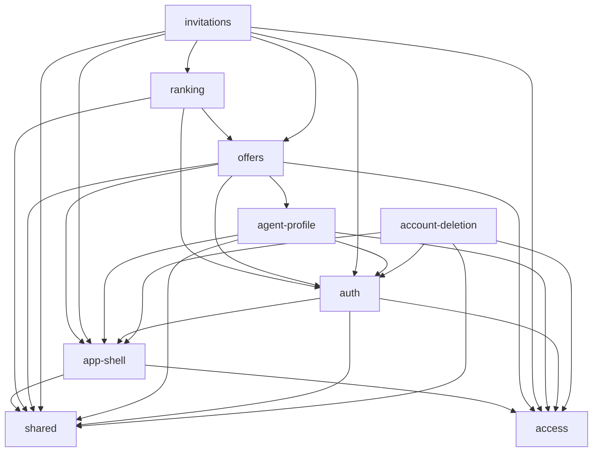

# Evidence: structure

Head `899b986`. Raw data in `context/map/.work/`: `edges-ts.csv` (file edges, `from,to,kind`), `file-caps.tsv` (attr.py output), `metrics-cap-runtime.md`, `cap-edges-runtime.txt`, `cap-graph.mmd`, `sql-table-refs.tsv`, `edges-url-forms.txt`, `unresolved-ts.txt` (empty).

## Graph sources

| Language                             | Files | Source                                                                                                                                        | Level                                | Confidence | Blind spots                                                                                                                           |
| ------------------------------------ | ----: | --------------------------------------------------------------------------------------------------------------------------------------------- | ------------------------------------ | ---------- | ------------------------------------------------------------------------------------------------------------------------------------- |
| TS (`.ts`, `.mjs`, `.js`)            |    42 | TypeScript 6.0.3 compiler parser (`ts.createSourceFile`) from `node_modules`, `@/` → `src/` resolved per tsconfig, relative resolved to files | 2 (toolchain)                        | high       | no dynamic `import()` found (0); 0 unresolved; Astro filesystem routing and `src/middleware.ts` wiring are by convention, not imports |
| TSX                                  |    18 | same                                                                                                                                          | 2                                    | high       | form `action="/api/..."` URL coupling (captured separately below)                                                                     |
| Astro                                |    27 | same parser over frontmatter + `<script>` blocks                                                                                              | 2 (parser) / 4 (extraction by regex) | medium     | template-only references (none expected: Astro requires frontmatter imports)                                                          |
| SQL (`supabase/migrations`, 8 files) |     8 | `rg` counts of table names, `create function/trigger/policy`, `references`, `create or replace`                                               | 4                                    | low        | no SQL parser; counts include comments and `-- down:` blocks                                                                          |

No graph tooling in the repo itself (no dependency rules in `eslint.config.js`, no dependency-cruiser/madge). Edges: 237 total = 199 runtime, 38 type-only, 0 build (config files import only external packages). Excluded from the capability graph: `tests/`, `supabase/tests/`, generated `src/db/database.types.ts`. Attribution: 0 graph files unmapped (`evidence`).

## Capability graph

Runtime edges between capabilities (file-edge counts, `evidence`):

| Node             |  Ca |  Ce | Instability | Outgoing (file edges)                                          |
| ---------------- | --: | --: | ----------: | -------------------------------------------------------------- |
| shared           |   7 |   0 |        0.00 | —                                                              |
| access           |   6 |   0 |        0.00 | —                                                              |
| app-shell        |   5 |   2 |        0.29 | shared 11, access 4                                            |
| auth             |   5 |   3 |        0.38 | shared 9, access 4, app-shell 3                                |
| offers           |   2 |   5 |        0.71 | shared 18, auth 6, access 5, agent-profile 3, app-shell 3      |
| ranking          |   1 |   3 |        0.75 | shared 4, auth 1, offers 1                                     |
| agent-profile    |   1 |   4 |        0.80 | shared 6, auth 4, access 2, app-shell 1                        |
| invitations      |   0 |   6 |        1.00 | shared 14, offers 10, auth 5, access 5, app-shell 3, ranking 1 |
| account-deletion |   0 |   4 |        1.00 | shared 5, auth 2, app-shell 2, access 2                        |

platform and docs have no runtime import edges into `src/`.

## Blast radius per capability

| Capability (crit.)      | Incoming at runtime                                                                                                                                | Outgoing                                          | Contracts imported by others                                                                                                                                                                                                                                                        | SQL coupling (`rg`, migrations)                                                                                                                                                                                      |
| ----------------------- | -------------------------------------------------------------------------------------------------------------------------------------------------- | ------------------------------------------------- | ----------------------------------------------------------------------------------------------------------------------------------------------------------------------------------------------------------------------------------------------------------------------------------- | -------------------------------------------------------------------------------------------------------------------------------------------------------------------------------------------------------------------- |
| access (high)           | 6 caps; `src/lib/supabase.ts` fan-in 18 files (auth 4, offers 5, invitations 5, agent-profile 2, account-deletion 1, access 1); `route-guard.ts` 7 | none                                              | `createClient`, `homeFor`/`isGated`/`requiredRole`                                                                                                                                                                                                                                  | middleware reads `profiles` (`.from("profiles")`); applies to every request by convention, not by import (`unknown` for the graph)                                                                                   |
| offers (high)           | invitations 10, ranking 1 file edges; `src/lib/services/offers.ts` fan-in 15 files                                                                 | agent-profile (`MAX_PRICE`, 3 edges)              | from `services/offers.ts`: `parseOfferId` (4 API endpoints incl. both invitations APIs), `formatOfferDate`/`formatPrice`/`formatArea`/`formatExperience`, `oneOf` (used by `services/invitations.ts`), `toOffer`; `OfferSummary.astro`, `DeleteOffer.tsx` used by invitations pages | `create_offers.sql` defines `rank_agents_for_offer` (the ranking RPC) and references `profiles` 5x; `owner_offer_management.sql` comments rely on the invitations trigger from account-deletion                      |
| invitations (high)      | none (entry/leaf of the graph)                                                                                                                     | offers 10, ranking 1, auth 5                      | —                                                                                                                                                                                                                                                                                   | `create_invitations.sql` creates policy `offers_select_invited_agent` **on `offers`** (offers 12 refs); `invitation_response.sql` does `create or replace function public.rank_agents_for_offer` (redefines ranking) |
| ranking (high)          | invitations 1 (`owner/offers/[id].astro` → `RankingList.astro`)                                                                                    | offers (`formatExperience`), auth (`ServerError`) | —                                                                                                                                                                                                                                                                                   | no own migration: the RPC lives in offers (defined) and invitations (replaced); called from `src/pages/owner/offers/[id].astro:57` (invitations). `RankingList.astro` posts to `/api/owner/invitations`              |
| auth (high)             | 5 caps, all via 3 UI components: `ServerError.tsx` fan-in 13, `SubmitButton.tsx` 7, `FormField.tsx`                                                | access, app-shell (`PublicLayout`)                | the 3 form components (de facto shared UI)                                                                                                                                                                                                                                          | `create_profiles.sql`: `handle_new_user` trigger on `auth.users`; `profiles` read in 8 API/page files across 5 caps for the per-endpoint role check                                                                  |
| account-deletion (high) | none                                                                                                                                               | auth, app-shell, access, shared                   | —                                                                                                                                                                                                                                                                                   | `account_deletion.sql` touches offers 9, invitations 5, auth.users 4; adds trigger `invitations_restore_offer_on_delete` on invitations that updates offers                                                          |
| agent-profile (med.)    | offers 3 (`MAX_PRICE`)                                                                                                                             | auth 4, access 2                                  | `MAX_PRICE`, type `MissingProfileField`                                                                                                                                                                                                                                             | adds columns/policy on `profiles` (auth's table)                                                                                                                                                                     |
| app-shell (med.)        | 5 caps (`AppLayout.astro` fan-in 9, `PublicLayout.astro` 4)                                                                                        | shared, access                                    | layouts                                                                                                                                                                                                                                                                             | `AppTopbar.astro` posts to `/api/auth/signout` (URL edge)                                                                                                                                                            |
| shared (med.)           | 7 caps; `utils.ts` 15, `ui/Card.astro` 15, `dictionaries.ts` 12, `ui/button.tsx` 9, `hooks/useNativeSubmitting.ts` 7                               | none                                              | —                                                                                                                                                                                                                                                                                   | —                                                                                                                                                                                                                    |

## Cycles

Runtime: **0** at capability level and at file level (`evidence`). The only file cycle is type-only (see Mechanical signals).

SQL (`inference` from `rg`): a schema-level loop exists across capabilities — offers' table `offers` gets an agent-read policy from invitations (`offers_select_invited_agent` reads `invitations`), invitations FK-cascades from `offers`, and account-deletion's trigger on `invitations` writes `offers`. The `owner_offer_management.sql` header explicitly avoids an `invitations` reference in offers policies to dodge "infinite recursion detected in policy".

## Broken boundaries

Intended layering (`inference` from CLAUDE.md and file layout): `shared`/`types` → `access` (client, guard) → `src/lib/services/*` (per-capability, pure) → components → pages/API (entry points).

| Break                                                                                | Edges                                                                                                                                          | Label                                                                                     |
| ------------------------------------------------------------------------------------ | ---------------------------------------------------------------------------------------------------------------------------------------------- | ----------------------------------------------------------------------------------------- |
| auth's form components act as shared UI                                              | 13 importers of `ServerError.tsx`, 7 of `SubmitButton.tsx`, `FormField.tsx` from offers, invitations, agent-profile, ranking, account-deletion | evidence (edges); inference (should live in shared)                                       |
| `services/offers.ts` is a general formatter/parser hub                               | 15 importers across offers, invitations, ranking; `services/invitations.ts` → `services/offers.ts` (`oneOf`)                                   | evidence                                                                                  |
| offers service depends on agent-profile service                                      | `services/offers.ts` → `services/agent-profile.ts` (`MAX_PRICE`)                                                                               | evidence                                                                                  |
| ranking logic split across offers + invitations SQL, rendered by an invitations page | `rank_agents_for_offer` in 3 migrations of 2 other caps; 0 ranking-owned migrations                                                            | evidence                                                                                  |
| data access bypasses services                                                        | 22 `.from(...)` and 4 `.rpc(...)` calls sit in pages/API routes; services contain no Supabase calls (only comments)                            | evidence; consistent with CLAUDE.md's per-endpoint role check, so a convention, not drift |
| access and shared import nothing from features                                       | 0 edges (clean)                                                                                                                                | evidence                                                                                  |

## Test risks

- **Pages/API own the queries** (26 Supabase calls in entry points): business rules there are testable only through integration/e2e, not by unit-testing services (`inference`). Services are pure → unit-testable without mocks (`evidence`: no `supabase` import in `src/lib/services`).
- **Ranking and invitation invariants live in SQL** (RPCs, policies, triggers): covered by `supabase/tests/*.sql` (offer-ranking 11 RPC refs, agent-invitation 20 `invite_agent`, invitation-response 15, account-deletion 11) and `tests/integration/{ranking,isolation}.test.ts`; TS unit tests cannot reach them (`evidence` counts; `inference` conclusion).
- `rank_agents_for_offer` is last redefined in `invitation_response.sql`; a test against the offers migration alone would test a stale definition (`inference`).
- Test helpers: `tests/e2e/helpers.ts` → `tests/integration/helpers.ts` (runtime edge), both type-depend on generated `database.types.ts` — a schema change ripples into both suites (`evidence`).

## Centres and thin entry points

- Load-bearing contracts (high Ca, instability 0): `src/lib/supabase.ts` (18), `src/lib/utils.ts` (15), `ui/Card.astro` (15), `dictionaries.ts` (12). `src/types.ts` has 29 type-only importers (rule 9, not runtime).
- Hidden centre: `src/lib/services/offers.ts` (fan-in 15, instability 0.71 at capability level) — a change to its formatters/parsers reaches offers, invitations and ranking.
- Thin entry points: `src/pages/dashboard.ts` only calls `homeFor` from route-guard; `src/middleware.ts` delegates to `supabase.ts` + `route-guard.ts`. invitations and account-deletion are pure entry capabilities (Ca 0) — their fan-out is the risk direction, not their fan-in.
- Rule 2 (config-as-code): none found; config files (`astro.config.mjs`, `vitest.config.ts`, `playwright.config.ts`, `eslint.config.js`) import only external packages.

## Mechanical signals

- Type-only edges: 38 (29 into `src/types.ts`, 7 into generated `database.types.ts`).
- Type-only 2-file cycle: `src/types.ts` ⇄ `src/lib/dictionaries.ts` (`import type` both ways) — no runtime effect.
- Build edges: 0. Generated `src/db/database.types.ts` excluded; its drift is guarded by CI (`npm run db:types` check per CLAUDE.local notes, rule 3).
- `create or replace` of `rank_agents_for_offer` appears twice in `invitation_response.sql` (lines 21 and 130); line 130 is in the `-- down:` block (restore), so one forward redefinition.

## Unknowns

- **URL coupling outside the import graph** (form `action`, 10 sites, `edges-url-forms.txt`): `RankingList.astro`(ranking) → `/api/owner/invitations`; `AppTopbar.astro`(app-shell) → `/api/auth/signout`; others stay within their capability. Fetch-by-URL not otherwise found.
- **Convention-wired runtime**: Astro middleware runs on every route; filesystem routing makes every page an entry; RLS policies apply to every query — none appear as edges (`unknown`, not "no dependencies").
- **SQL graph is regex-level**: counts include comments and down-blocks; no parser for policy→table or function→table edges. A SQL dependency extractor (e.g. `pg_depend` query against local Supabase) would make this precise.
- **External consumers**: none expected (no published package); Supabase RPCs are callable by any authenticated client directly (`unknown (external)`).
- Tool worth installing for TS: dependency-cruiser (would allow enforcing the boundaries above as rules).

Commands run: `node scratchpad/edges.cjs` (TS compiler parser → `edges-ts.csv`); `git ls-files | python3 context/map/.work/attr.py` → `file-caps.tsv`; `node .claude/skills/10x-repo-map/scripts/graph-metrics.mjs` (`--modules file-caps.tsv --kind runtime --exclude tests|database.types`, `--emit mermaid`, `--kind all` for cycles); python fold of cap→cap edges; `rg` for `@/lib/services/*` imports, `.rpc(`/`.from(`, `/api/` form actions, SQL `create function|trigger|policy`, `references`, table-name counts per migration and test.
