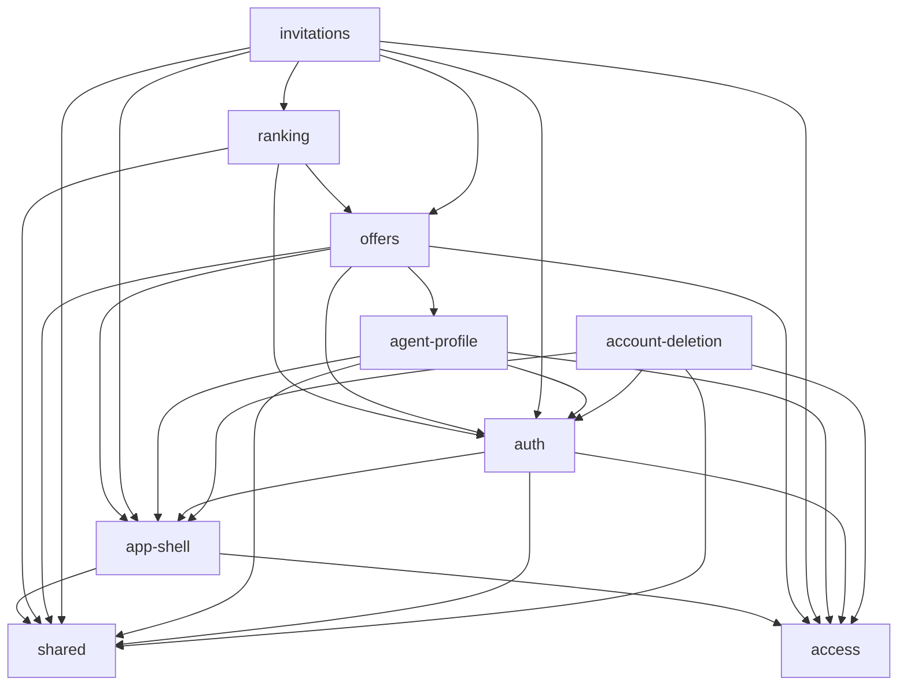

# Mapa projektu — helloDOM

## TL;DR

helloDOM łączy właścicieli nieruchomości z agentami: właściciel zakłada ofertę, system liczy dla każdego agenta wynik 0–100 i pokazuje top 3, właściciel zaprasza jednego, a agent przyjmuje albo odrzuca. Produkt to 8 możliwości biznesowych na jednym stosie Astro 7 SSR (Cloudflare Workers) + Supabase (Postgres, RLS, RPC). Repo ma 3 dni i jednego autora (73% commitów ze współautorem Claude); każda możliwość powstała jako osobny „slice” z planem, przeglądem i archiwum w `context/archive/`, więc aktywność w historii odzwierciedla kolejność budowy, a nie niestabilność. Prawdziwy nacisk jest w trzech miejscach: **zaproszenia** (najwięcej zmian i ustaleń przeglądów rdzenia produktu, cykl statusów oferty), **bramka sesji i ról** (każde żądanie przez nią przechodzi, a audyt observability wskazał dwie krytyczne ciche awarie) oraz **rejestracja i logowanie** (jedyne poprawki po wdrożeniu na produkcję). Najdalej sięgającym plikiem logiki jest `src/lib/services/offers.ts` (15 importerów w trzech możliwościach), a reguła rankingu żyje w SQL rozproszonym po migracjach ofert i zaproszeń.

(Graf importów runtime TS/TSX/Astro z `context/map/.work/cap-graph.mmd`; zależności przez SQL, RLS i URL-e formularzy nie są w nim widoczne — zob. Ograniczenia.)

## Teren

Buzz względem innych możliwości: **change** (aktywność), **fix** (presja poprawek), **friction** (drugie podejścia, PR-y bez merge), **attention** (plany, przeglądy, audyt), **reach** (zasięg runtime). Trend dzienny przy 3 dniach i jednocyfrowych liczbach ma niską wiarygodność — pomijam go.

| Możliwość        | Co robi                                                                   | Krytyczność                                     | change                                      | fix                                                                      | friction                                                                                      | attention                                                                             | reach                                                                                          | Gdzie żyje                                                                                                                                                                                 |
| ---------------- | ------------------------------------------------------------------------- | ----------------------------------------------- | ------------------------------------------- | ------------------------------------------------------------------------ | --------------------------------------------------------------------------------------------- | ------------------------------------------------------------------------------------- | ---------------------------------------------------------------------------------------------- | ------------------------------------------------------------------------------------------------------------------------------------------------------------------------------------------ |
| invitations      | zaproszenie agenta z rankingu, przyjęcie/odrzucenie, cykl statusów oferty | high (rdzeń, zmiana danych)                     | high (63 zmiany / 21 commitów)              | low (tylko zaplanowane impl-review)                                      | medium (przypadki brzegowe cyklu statusów w przeglądach: invited/locked, ponowne zaproszenie) | high (10 PR, 2 foldery zmian, 16 ustaleń przeglądów, 8 ustaleń audytu, 2 krytyczne)   | medium (Ce 6, najsilniejsza krawędź → offers: 10)                                              | `src/pages/api/{owner,agent}/invitations.ts`, `src/pages/owner/offers/[id].astro`, `src/pages/agent/`, `services/invitations.ts`, migracje `*create_invitations*`, `*invitation_response*` |
| access           | odświeżenie sesji, bramka ról `/owner` `/agent`, klient Supabase          | high (dostęp; zależy od niej każda strona)      | low (9 / 6)                                 | low                                                                      | low                                                                                           | high (2 krytyczne ustalenia audytu: A1, A2; brak własnego planu)                      | high (`supabase.ts` fan-in 18 plików z 6 możliwości; middleware na każdej trasie)              | `src/middleware.ts`, `src/lib/route-guard.ts`, `src/lib/supabase.ts`                                                                                                                       |
| auth             | rejestracja z rolą, logowanie, potwierdzenie e-mail, wylogowanie          | high (tożsamość, publiczne wejście)             | high (61 / 17)                              | high (fix share 35%; jedyne poprawki produkcyjne: callback, limit maili) | high (PR #4, #5 tuż po #3)                                                                    | medium (lekcja o potwierdzeniu e-mail, 3 high w audycie, impl-review NEEDS ATTENTION) | medium (Ca 5 — przez wspólne komponenty formularzy)                                            | `src/pages/api/auth/`, `src/pages/auth/`, `src/components/auth/`, `services/auth-*`                                                                                                        |
| offers           | tworzenie, lista, edycja, usuwanie ofert                                  | high (dane użytkownika, rdzeń)                  | medium (49 / 15)                            | low                                                                      | low                                                                                           | medium (strony degradujące do 200 w audycie)                                          | high (`services/offers.ts` fan-in 15 z offers, invitations, ranking)                           | `src/pages/owner/`, `src/pages/api/owner/offers*`, `OfferForm.tsx`, `services/offers.ts`, `*create_offers*`                                                                                |
| ranking          | wynik 0–100 i top 3 (RPC `rank_agents_for_offer`)                         | high (wartość rdzenia)                          | low (28 / 11; prawdziwe tempo SQL nieznane) | low (2 reverty = celowe uszkodzenie CI)                                  | low                                                                                           | medium (impl-review: RPC ujawnia `agent_id`; folder follow-ups)                       | low w TS (`RankingList.astro`), nieznany w SQL                                                 | `src/components/owner/RankingList.astro`; SQL w `20261028140000_create_offers.sql` i `20261028200000_invitation_response.sql`                                                              |
| account-deletion | usunięcie konta i wszystkich danych                                       | high (nieodwracalne usuwanie danych, wymóg PRD) | low (30 / 7)                                | low                                                                      | low                                                                                           | medium (krytyczne D1: `not_found` = sukces)                                           | low w TS (Ca 0); pętla triggerów offers ↔ invitations ↔ account-deletion w SQL (niska pewność) | `src/pages/api/account/delete.ts`, `src/components/account/`, `*account_deletion*`                                                                                                         |
| agent-profile    | miasta, typy, przedział cen, staż agenta                                  | medium (dane wejściowe rankingu)                | low (30 / 8)                                | low                                                                      | low (PR #7 zamknięty bez merge — konflikt workflow, ponownie jako #10)                        | low                                                                                   | low (`MAX_PRICE` importowane przez `services/offers.ts`)                                       | `src/pages/agent/profile.astro`, `src/pages/api/agent/profile.ts`, `services/agent-profile.ts`                                                                                             |
| app-shell        | layouty, nawigacja, landing                                               | medium (każda strona przez nie renderuje)       | medium (44 / 13)                            | low                                                                      | low                                                                                           | medium (10 ustaleń impl-review: kontrast WCAG, `?error=`)                             | medium                                                                                         | `src/components/shell/`, `src/layouts/`                                                                                                                                                    |

- **Platforma i infrastruktura** — CI/CD z deployem po merge, smoke, Playwright, Vitest, hooki agenta; najczęściej zmieniana (99 zmian / 41 commitów), ale mechanicznie: `scripts/smoke.mjs` rozszerza każdy slice, a 28–29.10 to kampania testowa.
- **Wspólne fundamenty** — UI kit (`src/components/ui/`), `dictionaries.ts`, `types.ts`, `utils.ts`.
- **Dokumentacja i planowanie** — `context/foundation/` (PRD, roadmapa, test-plan, lekcje), audyt, README/CLAUDE/AGENTS.
- **Pokrycie:** 0% nieprzypisanych zmian (po zmapowaniu ścieżek usuniętych/przeniesionych); kategorie zbiorcze: platform 21,3% + shared 7,3% + docs 12,4% = 41% wszystkich zmian (nieco ponad próg 40% — platforma jest duża, bo jeden z 3 dni poszedł na CI i testy).
- **Struktura folderów a możliwości:** jedna możliwość jest rozrzucona po `src/pages`, `src/pages/api`, `src/components/<rola>`, `src/lib/services` i `supabase/migrations`; jeden folder obsługuje kilka możliwości — `src/pages/owner/offers/[id].astro` to jednocześnie oferta, ranking i zaproszenie, a `src/components/auth/` zawiera wspólne komponenty formularzy (`ServerError.tsx` fan-in 13, `SubmitButton.tsx` 7, `FormField.tsx`) używane w całej aplikacji.

## Realne powiązania

| Powiązanie                                                                                                               | Skąd wiadomo                                                         | Mechaniczne?                        |
| ------------------------------------------------------------------------------------------------------------------------ | -------------------------------------------------------------------- | ----------------------------------- |
| invitations → offers (10 krawędzi plikowych)                                                                             | graf runtime TS                                                      | nie                                 |
| offers → agent-profile (`MAX_PRICE` z `services/agent-profile.ts`)                                                       | graf runtime TS                                                      | nie (granica złamana w małej skali) |
| wszystkie → access (`src/lib/supabase.ts`, 18 importerów; `route-guard.ts`, 7)                                           | graf runtime TS                                                      | nie                                 |
| offers ↔ ranking ↔ invitations przez `services/offers.ts`, `owner/offers/[id].astro`, `OfferForm.tsx`                    | co-change (offers–ranking conf 0,43; invitations–offers 0,36) + graf | nie                                 |
| ranking SQL: `rank_agents_for_offer` zdefiniowane w migracji ofert, nadpisane (`create or replace`) w migracji zaproszeń | `rg` po migracjach                                                   | nie — kontrakt utrzymywany ręcznie  |
| invitations → offers w RLS (policy `offers_select_invited_agent` na `offers` w migracji zaproszeń)                       | `rg` po migracjach                                                   | nie                                 |
| account-deletion → invitations → offers (trigger przywraca status oferty przy usuwaniu zaproszeń)                        | `rg` po migracjach; wniosek                                          | nie                                 |
| RankingList → `/api/owner/invitations`, InvitationResponse → `/api/agent/invitations` (URL w `action`, 10 miejsc)        | `rg` po `action=`                                                    | nie, niewidoczne w grafie           |
| `src/types.ts` ⇄ `src/lib/dictionaries.ts` (cykl type-only)                                                              | graf TS                                                              | mechaniczne                         |
| `src/db/database.types.ts` ↔ migracje                                                                                    | regeneracja `npm run db:types`, sprawdzana w CI                      | mechaniczne                         |
| każda możliwość ↔ `scripts/smoke.mjs`, ↔ `context/foundation/roadmap.md`                                                 | co-change                                                            | mechaniczne (lockstep workflow)     |

**Pytania ze sprzeczności:**

- `ranking` to najważniejsza wartość produktu, a ma najmniej własnego kodu i ruchu — czy reguła punktacji w SQL ma właściciela, skoro żyje w dwóch migracjach innych możliwości?
- `access` ma najwyższy zasięg i dwa krytyczne ustalenia audytu, a nikt nie napisał dla niej osobnego planu — czy middleware jest świadomie traktowane jako infrastruktura?
- Pary, które powinny zmieniać się razem, a historia tego nie pokazuje: SQL rankingu ↔ `tests/integration/ranking.test.ts` / `supabase/tests/offer-ranking.sql`; polityki RLS ↔ `tests/integration/isolation.test.ts`; `dictionaries.ts` ↔ check constraints w bazie.

## Strefy ryzyka

1. **Zaproszenia i cykl statusów oferty** — rdzeń produktu, najwięcej zmian i najwięcej ustaleń przeglądów, a stan (seeking_agent → invited → in_progress) pilnują RPC, indeks unikalny i trigger rozrzucone po migracjach.
   - Sygnały niezależne: change high (`1-history.md`, tabela aktywności: 63/21); attention high (`2-discussion.md`: 10 PR, 16 ustaleń przeglądów, audyt O1/O2 critical); reach medium (`3-structure.md`: Ce 6, invitations → offers 10 krawędzi). Change i attention mają częściowo wspólną przyczynę (duży slice), ale ustalenia audytu i przeglądów dotyczą treści, nie objętości.
   - Pliki: `src/pages/owner/offers/[id].astro`, `src/pages/api/owner/invitations.ts`, `src/pages/api/agent/invitations.ts`, `src/pages/agent/offers/[id].astro`, `src/lib/services/invitations.ts`, `supabase/migrations/20261028180000_create_invitations.sql`, `supabase/migrations/20261028200000_invitation_response.sql`.
2. **Bramka sesji i ról** — każda strona i endpoint przechodzi przez middleware i klienta Supabase; awaria Supabase Auth wygląda jak wylogowanie, a regresja RLS na `profiles` po cichu wylogowuje wszystkich.
   - Sygnały niezależne: reach high (`3-structure.md`: `supabase.ts` fan-in 18 z 6 możliwości, middleware na każdej trasie); attention high (`2-discussion.md`: audyt A1, A2 critical). Krytyczność z kryteriów dostępu i zależności runtime.
   - Pliki: `src/middleware.ts`, `src/lib/supabase.ts`, `src/lib/route-guard.ts`.
3. **Rejestracja, logowanie i potwierdzenie e-mail** — jedyna możliwość z prawdziwymi poprawkami po wdrożeniu; działa inaczej lokalnie (potwierdzenia wyłączone) niż na produkcji.
   - Sygnały niezależne: fix pressure + friction (jedna przyczyna, liczona raz: `1-history.md` d4717df, e584f83; `2-discussion.md` PR #4, #5 po #3); attention (`2-discussion.md`: audyt 3 high — A4 kody błędów, A5 callback, A6 `catch {}`; lekcja w `context/foundation/lessons.md` — ta sama przyczyna co poprawki, więc wzmacnia, nie dubluje); reach medium (`3-structure.md`: Ca 5 przez wspólne komponenty formularzy).
   - Pliki: `src/pages/api/auth/signup.ts`, `src/pages/auth/callback.ts`, `src/lib/services/auth-errors.ts`, `src/components/auth/SignUpForm.tsx`.

**Do obserwacji (nie spełniają progu):**

- **offers jako centrum zależności** — `src/lib/services/offers.ts` (fan-in 15; `oneOf`, `parseOfferId`, formattery) jest wspólną biblioteką trzech możliwości; reach high, ale reszta buzz medium/low.
- **ranking** — wartość rdzenia, SQL bez własnej migracji i z ręcznie utrzymywanym kontraktem; impl-review wskazał ujawnianie `agent_id` przez RPC. Tempo zmian SQL nieznane (atrybucja ścieżek).
- **account-deletion** — krytyczne ustalenie audytu D1 (`not_found` traktowane jak sukces) i pętla triggerów w SQL, ale niski ruch i niski zasięg w TS.

**Wygląda gorąco, a nie jest:**

- platforma: 99 zmian i 41 commitów, `scripts/smoke.mjs` najczęściej zmieniany — lockstep każdego slice'a i jednodniowa kampania testowa;
- dokumentacja i `roadmap.md` (hub 9 partnerów) — każdy slice ją aktualizuje;
- commity `fix(...)` w niemal każdej możliwości — zaplanowany krok „impl-review fixes”;
- 2 reverty w ranking i czerwone CI na PR #20 — celowe uszkodzenie dowodzące działania testu;
- PR #7 zamknięty bez merge — konflikt z zarchiwizowanym folderem, wylądował jako #10;
- 10 ustaleń impl-review w app-shell — realne (kontrast, `?error=`), ale już poprawione i niekrytyczne dla danych;
- cykl `types.ts` ⇄ `dictionaries.ts` — wyłącznie typy.

## Kogo zapytać

Jeden człowiek w historii (bkreczmer; konto `bartek_dev` wykonało tylko merge PR-ów i najpewniej jest tą samą osobą), więc każda możliwość ma bus factor 1 — to punkt odniesienia, nie ustalenie. Zastępstwem dla rozmowy są foldery zmian:

| Strefa                  | Osoba     | Gdzie zamiast pytać                                                                                                                                          |
| ----------------------- | --------- | ------------------------------------------------------------------------------------------------------------------------------------------------------------ |
| Zaproszenia             | bkreczmer | `context/archive/2026-10-28-agent-invitation/`, `context/archive/2026-10-28-invitation-response/`, 10 PR-ów (lista w `context/map/evidence/2-discussion.md`) |
| Bramka sesji i ról      | bkreczmer | `context/archive/2026-10-27-role-based-signup/` (middleware powstał w tym slice'ie), audyt `context/audits/observability/2026-10-29_*.md`                    |
| Rejestracja i logowanie | bkreczmer | `context/archive/2026-10-27-role-based-signup/`, `context/foundation/lessons.md`, PR #3–#5                                                                   |

## Pierwszy dzień

1. `src/middleware.ts` + `src/lib/route-guard.ts` — jak żądanie dostaje użytkownika, profil i rolę; tu zaczyna się każdy przepływ.
2. `src/lib/supabase.ts` — klient SSR z ciasteczek; zależy od niego 18 plików.
3. `src/pages/owner/offers/[id].astro` — strona, na której spotykają się oferta, ranking (wywołanie RPC) i zaproszenie; najlepszy punkt wejścia do rdzenia.
4. `src/lib/services/offers.ts` — wspólna logika ofert używana przez trzy możliwości (mapowania, walidacja, `oneOf`).
5. `supabase/migrations/20261028200000_invitation_response.sql` — aktualna definicja `rank_agents_for_offer` (reguła PRD w SQL) i `respond_to_invitation` (przejścia statusów).
6. `src/pages/api/agent/invitations.ts` + `src/pages/agent/offers/[id].astro` — druga strona pętli: agent przyjmuje albo odrzuca.
7. `src/pages/api/auth/signup.ts` + `src/pages/auth/callback.ts` — rejestracja z rolą i potwierdzenie e-mail, czyli jedyna część z historią poprawek produkcyjnych.
8. `tests/e2e/critical-path.spec.ts` — cała ścieżka właściciel → agent opisana jednym testem, z wyrocznią z PRD.

## Ograniczenia

- **Okno:** cała historia to 3 dni (27–29.10.2026), 91 policzonych commitów, 1 autor z 73% commitów współtworzonych przez agenta. Trendy, koncentracja i „churn” mówią o kolejności budowy, nie o stabilności w czasie.
- **Źródła:** git + GitHub (23 PR-y, 0 issues, 64 przebiegi CI, 2 czerwone — oba wyjaśnione). Wszystkie przeglądy to samoprzeglądy przez skille; brak ludzkich recenzji.
- **Pokrycie grafu:** TS/TSX wysokie, Astro średnie (frontmatter), SQL niskie (`rg`, bez parsera; dokładne zależności dałby `pg_depend` na lokalnym Supabase). Poza grafem (`unknown`): middleware i routing plikowy podpinane konwencją, RLS na każdym zapytaniu, sprzężenia przez URL w `action` formularzy, RPC wywoływalne bezpośrednio przez klienta (`unknown (external)`).
- **Pokrycie możliwości:** 0% nieprzypisane; kategorie zbiorcze 41% zmian. Ranking jest niedoszacowany: jego SQL leży w migracjach ofert i zaproszeń, więc rzeczywiste tempo zmian reguły jest nieznane; z tego samego powodu audyt observability ma 0 ustaleń przypisanych do ranking.
- **Czego mapa nie mówi:** czy na produkcji wystąpiły incydenty bez commita `fix` (brak issue trackera i trackera błędów; audyt observability pokazuje, że większość awarii nie zostawia logów); czy pary SQL ↔ testy ↔ słowniki zmieniają się razem; formalnej własności (brak CODEOWNERS).
- **Warte ukierunkowanego badania:** (1) kontrakt `rank_agents_for_offer` — kto i gdzie go zmienia, i czy testy SQL/integracyjne zmieniają się razem z nim; (2) zależności SQL przez `pg_depend` (pętla triggerów usuwania konta); (3) wydzielenie wspólnych komponentów formularzy z `src/components/auth/`.
- **Agenci:** wszyscy czterej zakończyli pracę; brak częściowych wyników.
